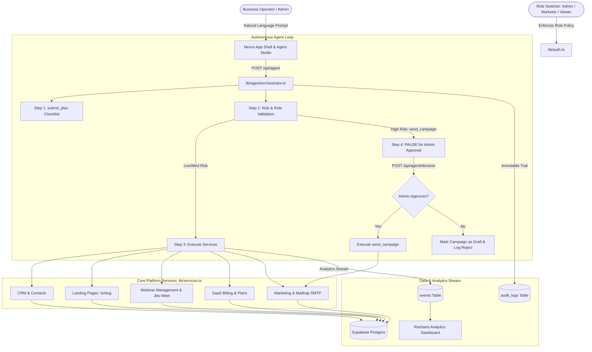

# Nexus: The AI-Powered Business Operating Platform

> **Hackathon Demo Submission**  
> Unifying website builder, CRM, SaaS billing, marketing automation, and webinar management under an autonomous AI agent with permissions, human approval checkpoints, and audit logging.

---

## 🏛️ Architecture Overview



---

## 🚀 Quick Start & Setup Steps

### 1. Install Dependencies
```bash
npm install
```

### 2. Configure Environment Variables
Copy `.env.example` to `.env.local` or `.env`:
```bash
cp .env.example .env.local
```
Fill in the keys (all services are 100% free with no credit card required):
- `SUPABASE_URL` and `SUPABASE_SERVICE_ROLE_KEY`: From your free [Supabase](https://supabase.com) project.
- `GEMINI_API_KEY`: From free [Google AI Studio](https://aistudio.google.com).
- `SMTP_USER` and `SMTP_PASS`: From your free [Mailtrap Sandbox](https://mailtrap.io) SMTP settings.

*(Note: Nexus features an automated built-in fallback store seeded with 50 contacts, 3 plans, 3 segments, and 120 analytics events so that the entire demo is immediately testable and navigable even before configuring external database credentials).*

### 3. Initialize Supabase Database (Optional if using Supabase)
Run the complete schema and seed script located at:
```
supabase/schema.sql
```
This sets up all 13 relational tables and populates the default workspace `00000000-0000-0000-0000-000000000001` with contacts, plans, webinars, and analytics events.

### 4. Run Development Server
```bash
npm run dev
```
Open [http://localhost:3000](http://localhost:3000) in your browser.

---

## 🎯 The Demo Script (Hackathon Walkthrough)

### Primary Demo Instruction
Navigate to `/agent` and click or paste the primary demo prompt:
```text
"Launch a webinar on AI in retail next Friday. Create a landing page, email my retail leads, and set up a paid ticket plan."
```

### What Happens Step-by-Step:
1. **Plan Checklist**: The agent submits an ordered plan with 8 milestones (`submit_plan`).
2. **Segment Creation**: Targets contacts tagged `retail` (`create_segment`).
3. **Landing Page**: Generates and publishes `/s/ai-retail-summit` (`create_page`).
4. **Paid Ticket Plan**: Creates `Webinar VIP Ticket` at $99.00 (`create_plan`).
5. **Webinar Setup**: Schedules the session with an instant Jitsi Meet room link (`create_webinar`).
6. **Campaign Draft**: Drafts personalized invitation email for retail leads (`draft_campaign`).
7. **Human-in-the-Loop Checkpoint**: The agent detects high-risk `send_campaign` and **PAUSES** execution with status `awaiting_approval`.
8. **Admin Approval**:
   - If the active role is **Marketer** or **Viewer**, the approve button is disabled ("Only an Admin can approve").
   - Switch role to **Admin** via the top-right switcher.
   - Click **Approve & Send**.
   - Emails are delivered to the Mailtrap Sandbox (capped at 20 recipients).
   - Agent reports final completion summary!

---

## 🛡️ Risk & Permission Matrix

| Tool | Risk Tier | Allowed Roles | Governance Behavior |
| :--- | :---: | :---: | :--- |
| `submit_plan` | **Low** | Admin, Marketer, Viewer | Auto-run, surfaces step checklist |
| `query_analytics` | **Low** | Admin, Marketer, Viewer | Read-only metrics query |
| `create_segment` | **Low** | Admin, Marketer | Auto-run; creates filtered audience |
| `draft_campaign` | **Low** | Admin, Marketer | Auto-run; saves campaign draft |
| `create_webinar` | **Medium** | Admin, Marketer | Auto-run & logged; allocates Jitsi room |
| `create_page` | **Medium** | Admin, Marketer | Auto-run & logged; publishes `/s/[slug]` |
| `create_plan` | **Medium** | **Admin Only** | Blocked for Marketer/Viewer; creates billing plan |
| `send_campaign` | **High** | **Admin Approval Required** | **PAUSES run** until Admin reviews recipient count and subject |

---

## 🔍 What Is Mocked & Simulated (Honesty Section)

1. **Role Switcher**: Implemented via a `role` cookie (`admin`, `marketer`, `viewer`) rather than full JWT/OAuth auth to maximize demo velocity.
2. **SaaS Billing**: Plan creation is fully functional and tracked in Postgres; the "Subscribe" button simulates payment completion and inserts a row into `subscriptions` without requiring Stripe or real credit cards.
3. **Webinar Rooms**: Generated using free Jitsi Meet links (`https://meet.jit.si/<room>`). No paid Zoom or API keys required. Attendance is toggled via the UI.
4. **Estimated Hours Saved**: Computed as `0.1 hours (6 minutes)` per executed agent action.
5. **Email Delivery**: Uses Nodemailer connected to Mailtrap sandbox SMTP (`sandbox.smtp.mailtrap.io:2525`). Outgoing emails safely land in your test inbox and never reach real people.
